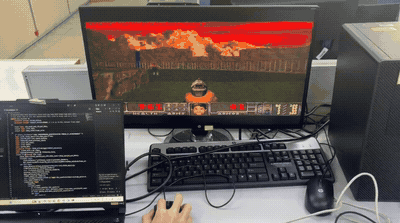
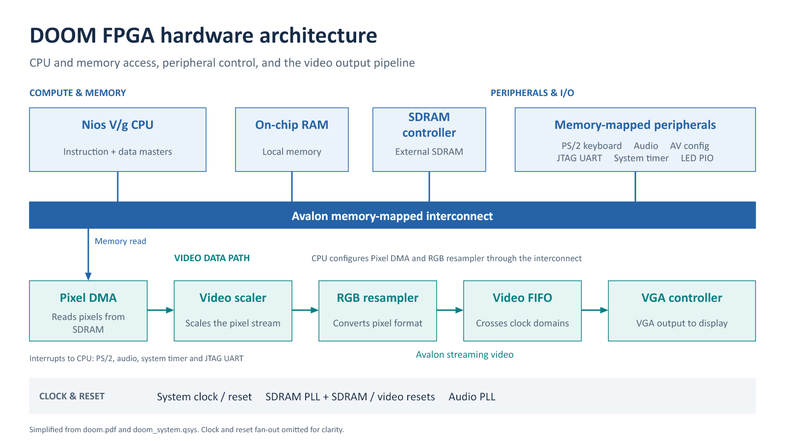

# DOOM on an FPGA RISC-V soft processor

DOOM running on an **Intel Nios V/g RISC-V soft processor** on a **Terasic DE2-115** board (Cyclone IV E EP4CE115), with VGA video, a PS/2 keyboard and sound effects through the on-board audio codec.

*Running on the DE2-115 during the internship (Sep 2026).*

I built the system **twice**:

1. **[`v1-custom-rtl/`](v1-custom-rtl)**: the peripherals are my own Verilog (about 1,100 lines): an SDRAM controller, a VGA framebuffer with hardware palette, and a PS/2 receiver.
2. **[`v2-ip-based/`](v2-ip-based)**: the same system rebuilt on Intel/Altera IP in Platform Designer, with a 100 MHz SDRAM controller, a DMA video pipeline and audio. This is the final version, and it runs at about 30 FPS on the on-screen counter.

The work was done during the **VeCAD Elite Internship Programme**, Faculty of Electrical Engineering, Universiti Teknologi Malaysia (Sep 2026).

## v1 vs v2

| | v1: custom RTL | v2: IP-based (final) |
|---|---|---|
| CPU | Nios V/g, 50 MHz, 16 KiB I-cache + 16 KiB D-cache | same |
| SDRAM | My own Avalon-MM controller ([`doom_sdram.v`](v1-custom-rtl/rtl/doom_sdram.v)), 50 MHz, CAS 2, one word per access with auto-precharge | Altera SDRAM controller at 100 MHz from a PLL, wrapped as a Platform Designer component |
| Video | My own VGA timing, two 320 × 200 8-bit framebuffers in on-chip RAM, 256-entry hardware palette, vsync frame swap | Pixel-buffer DMA → RGB resampler → scaler → dual-clock FIFO → VGA controller; two 320 × 240 RGB565 framebuffers in an uncached SDRAM region |
| Keyboard | My own PS/2 receiver with FIFO and error flags | University Program PS/2 core, polled, with a software scan-code decoder |
| Timer | My own millisecond counter | Avalon interval timer |
| Audio | none | University Program audio core + codec set-up over I²C; interrupt-driven mixer, 8 voices, 48 kHz stereo |
| Logic elements | 10,096 / 114,480 (9%) | 14,333 / 114,480 (13%) |
| On-chip memory | 1,482,640 bits (37%) | 833,168 bits (21%) |
| PLLs | 0 | 2 |

The fitter summaries are in `*/hardware/reports/`.

### Why I moved from custom RTL to IP

- **Memory speed.** My SDRAM controller opens and closes a row for every single word, and the CPU's cache-line fills arrive as a series of separate accesses. The IP controller runs at twice the clock and pipelines consecutive accesses. That matters because DOOM's code, data and framebuffers all live in SDRAM.
- **On-chip memory.** v1 kept both framebuffers in M9K block RAM. Moving them to SDRAM, with DMA scan-out, cut on-chip memory use from 37% to 21%.
- **Features.** The IP route made it practical to add audio (codec configuration, clock generation, FIFOs) in the time available.

Writing v1 first meant I understood what each IP block was doing for me (Avalon-MM handshaking, SDRAM initialisation and refresh, VGA timing, PS/2 framing) before I replaced it.

## Software

The game is [doomgeneric](https://github.com/ozkl/doomgeneric) (commit `dcb7a8d`), running bare-metal on the Nios V HAL. My board-support code is in `software/app/src/`:

| File | What it does |
|---|---|
| `doomgeneric_niosv.c` | The doomgeneric platform layer: frame output, double buffering, timing, key events and the FPS overlay. In v2, it converts the 8-bit indexed frame to RGB565 for the DMA framebuffer. |
| `ps2_keys.c` | PS/2 scan-code set 2 decoder (make/break and extended codes), mapped to DOOM keys. |
| `ramfs.c`, `niosv_fs.c` | A small RAM filesystem, so the engine's `fopen`/`fread` calls can read the WAD linked into the executable (`wad.S`) and write config and save files. |
| `doom_audio.c` (v2) | Sound effects: decodes DOOM's sound lumps and mixes up to 8 voices into the audio FIFO from an interrupt, at 48 kHz stereo. |
| `doom_diag.c` (v2) | Fault handling: shows a fault code on the LEDs and keeps the error message in memory so it can be read with the debugger. |

Changes to the doomgeneric engine itself (in `software/app/doomgeneric/`):
- `m_controls.c`: WASD movement, Right Ctrl to fire, Space to use.
- `doomgeneric.c`: allocates the screen buffer by pixel size.
- `i_system.c`: routes fatal errors to the board diagnostics.
- `i_sound.c` (v2): disables the desktop sound modules so the board mixer is used.

**Controls:** WASD to move, arrow keys to turn, Right Ctrl to fire, Space to open doors.

## Building

You need Quartus Prime Lite 25.1 with Nios V support, the Nios V BSP Editor and RiscFree (or CMake with the RISC-V toolchain), a DE2-115, a VGA monitor and a PS/2 keyboard.

1. **Game data:** put your own `DOOM.WAD` in `v2-ip-based/assets/` (or `v1-custom-rtl/software/app/assets/`). It isn't included; see the README in that folder.
2. **Hardware:** open `hardware/doom_system.qsys` in Platform Designer and click **Generate HDL**. Then open `hardware/doom.qpf` in Quartus, compile, and program the `.sof`.
3. **BSP:** open `software/bsp/settings.bsp` in the Nios V BSP Editor, point it to the generated `doom_system.sopcinfo`, and generate. The checklist is in [`v2-ip-based/software/BSP_EDITOR_GUIDE.md`](v2-ip-based/software/BSP_EDITOR_GUIDE.md).
4. **Application:** build `software/app` with CMake, then download `doom.elf` to the board.

## Notes and limitations

- The frame rate is from the on-screen counter during gameplay, not a controlled benchmark. DOOM's engine is capped at 35 FPS.
- The Quartus timing report shows positive internal setup and hold slack. External I/O delay constraints for SDRAM and VGA are not complete.
- Music (OPL3) was tried during development but is not part of the final build.

## Credits and licence

- **doomgeneric** by ozkl, based on Chocolate Doom and id Software's DOOM source: GPL-2.0.
- **Intel/Altera IP:** Nios V/g, University Program video, audio and PS/2 cores, and the SDRAM controller (`DE2_115_QSYS_sdram.v`, generated by Altera tools and taken from the Terasic DE2-115 system CD). These are subject to Intel's licence terms.
- **DOOM game data** is not included.

My own code in this repository is released under the **GPL-2.0** licence (see [`LICENSE`](LICENSE)), the same as doomgeneric.